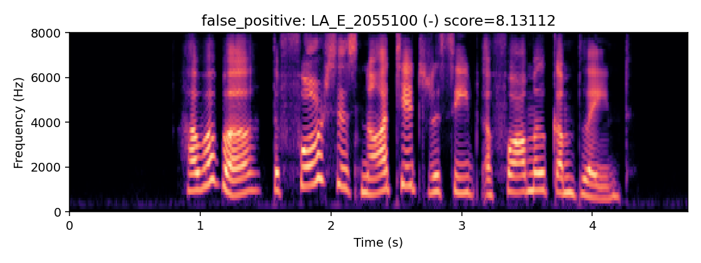
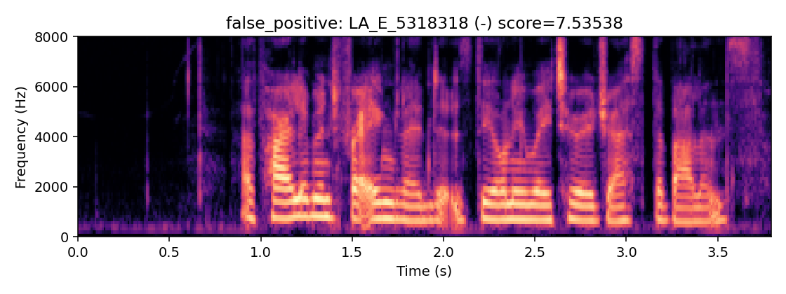
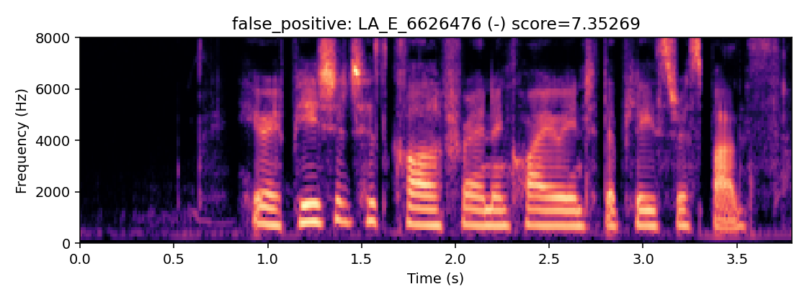
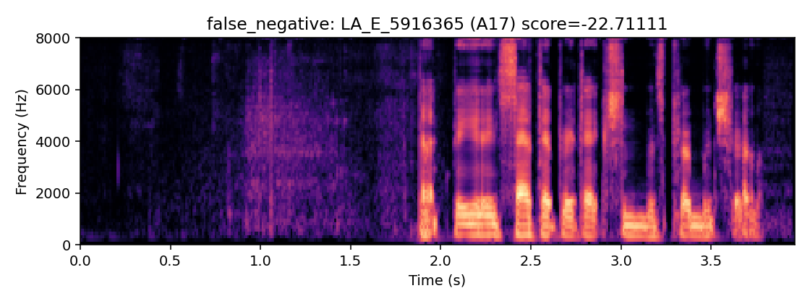
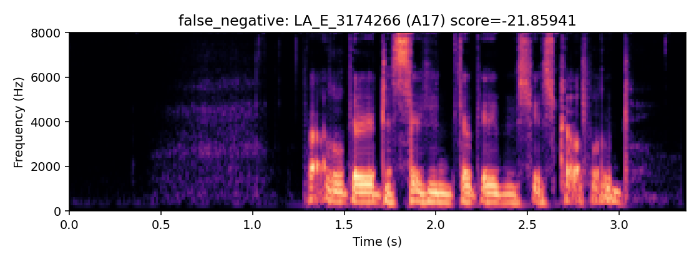
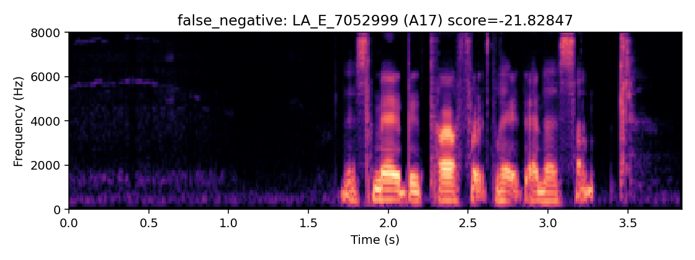

# Phase 4A: saved-score analysis

All CNN/SVM evaluations use frozen DEV thresholds and saved clean EVAL scores. The shortcut model was fit on TRAIN nuisance cues; its threshold was selected on DEV only.

## Attack taxonomy

| Classification | Attack IDs | Interpretation |
|---|---|---|
| Unknown systems | A07–A15, A17, A18 | 11 unknown ASVspoof systems |
| Known reused references | A16, A19 | A16 reuses A04's algorithm; A19 reuses A06's algorithm |

The Wang et al. database paper states that A07–A19 excluding A16/A19 are the 11 unknown systems, and identifies A16/A04 and A19/A06 algorithm reuse. It also states A17 uses the same VAE-based framework as A05 but a generalized direct waveform-modification method instead of WORLD. This describes generalization to unseen ASVspoof systems only; it is not universal or out-of-dataset generalization. [Wang et al. (2020), paper PDF](https://www.research.ed.ac.uk/files/157030755/ASVspoof_2019_WANG_DOA08052020_AFV.pdf).

## Unknown systems and reused references

| Model | Group | Attacks | Bona fide / spoof N | Pooled EER | Spoof recall @ frozen threshold | Miss rate @ frozen threshold |
|---|---|---|---:|---:|---:|---:|
| CNN | unknown_11 | A07, A08, A09, A10, A11, A12, A13, A14, A15, A17, A18 | 7355 / 54054 | 9.298% | 74.625% | 25.375% |
| CNN | known_reused_A16_A19 | A16, A19 | 7355 / 9828 | 2.025% | 96.205% | 3.795% |
| SVM | unknown_11 | A07, A08, A09, A10, A11, A12, A13, A14, A15, A17, A18 | 7355 / 54054 | 10.604% | 84.134% | 15.866% |
| SVM | known_reused_A16_A19 | A16, A19 | 7355 / 9828 | 21.399% | 50.916% | 49.084% |

## Per-speaker EVAL error rates

FPR denominator is that speaker's bona fide trials; miss denominator is that speaker's spoof trials. N/A indicates no trials of that class.

| Speaker | BF FP / N | BF FPR CNN | Spoof FN / N | Spoof miss CNN | BF FPR SVM | Spoof miss SVM |
|---|---:|---:|---:|---:|---:|---:|
| LA_0001 | 0 / 68 | 0.000% | 101 / 936 | 10.791% | 22.059% | 14.316% |
| LA_0002 | 0 / 68 | 0.000% | 79 / 936 | 8.440% | 0.000% | 18.803% |
| LA_0003 | 0 / 68 | 0.000% | 279 / 936 | 29.808% | 0.000% | 17.842% |
| LA_0004 | 0 / 146 | 0.000% | 459 / 1638 | 28.022% | 0.000% | 24.786% |
| LA_0005 | 0 / 68 | 0.000% | 209 / 936 | 22.329% | 0.000% | 25.000% |
| LA_0006 | 0 / 146 | 0.000% | 609 / 1638 | 37.179% | 0.000% | 22.711% |
| LA_0007 | 0 / 68 | 0.000% | 100 / 936 | 10.684% | 0.000% | 19.444% |
| LA_0008 | 0 / 146 | 0.000% | 421 / 1638 | 25.702% | 0.685% | 20.879% |
| LA_0009 | 0 / 146 | 0.000% | 353 / 1638 | 21.551% | 0.685% | 20.085% |
| LA_0010 | 0 / 146 | 0.000% | 219 / 1638 | 13.370% | 6.849% | 20.757% |
| LA_0011 | 0 / 68 | 0.000% | 393 / 936 | 41.987% | 11.765% | 16.560% |
| LA_0012 | 6 / 146 | 4.110% | 244 / 1638 | 14.896% | 0.000% | 20.330% |
| LA_0013 | 0 / 68 | 0.000% | 126 / 936 | 13.462% | 0.000% | 16.880% |
| LA_0014 | 0 / 146 | 0.000% | 268 / 1638 | 16.361% | 2.740% | 19.841% |
| LA_0015 | 0 / 68 | 0.000% | 462 / 936 | 49.359% | 1.471% | 21.474% |
| LA_0016 | 0 / 146 | 0.000% | 234 / 1638 | 14.286% | 5.479% | 21.306% |
| LA_0017 | 0 / 146 | 0.000% | 564 / 1638 | 34.432% | 0.000% | 25.214% |
| LA_0018 | 0 / 68 | 0.000% | 115 / 936 | 12.286% | 0.000% | 20.726% |
| LA_0019 | 1 / 146 | 0.685% | 376 / 1638 | 22.955% | 0.000% | 22.283% |
| LA_0020 | 0 / 146 | 0.000% | 290 / 1638 | 17.705% | 0.000% | 20.757% |
| LA_0021 | 0 / 68 | 0.000% | 188 / 936 | 20.085% | 4.412% | 15.812% |
| LA_0022 | 0 / 146 | 0.000% | 179 / 1638 | 10.928% | 0.000% | 25.336% |
| LA_0023 | 1 / 68 | 1.471% | 111 / 936 | 11.859% | 7.353% | 20.406% |
| LA_0024 | 0 / 146 | 0.000% | 211 / 1638 | 12.882% | 0.000% | 23.199% |
| LA_0025 | 0 / 68 | 0.000% | 115 / 936 | 12.286% | 0.000% | 19.979% |
| LA_0026 | 0 / 146 | 0.000% | 660 / 1638 | 40.293% | 0.000% | 32.173% |
| LA_0027 | 0 / 146 | 0.000% | 604 / 1638 | 36.874% | 0.000% | 25.214% |
| LA_0028 | 0 / 68 | 0.000% | 189 / 936 | 20.192% | 23.529% | 16.239% |
| LA_0029 | 0 / 146 | 0.000% | 283 / 1638 | 17.277% | 0.000% | 23.810% |
| LA_0030 | 0 / 68 | 0.000% | 140 / 936 | 14.957% | 26.471% | 12.821% |
| LA_0031 | 0 / 146 | 0.000% | 450 / 1638 | 27.473% | 0.000% | 18.803% |
| LA_0032 | 0 / 68 | 0.000% | 417 / 936 | 44.551% | 75.000% | 16.667% |
| LA_0033 | 1 / 146 | 0.685% | 415 / 1638 | 25.336% | 4.110% | 21.978% |
| LA_0034 | 0 / 146 | 0.000% | 320 / 1638 | 19.536% | 3.425% | 21.001% |
| LA_0035 | 0 / 146 | 0.000% | 369 / 1638 | 22.527% | 0.000% | 20.391% |
| LA_0036 | 0 / 68 | 0.000% | 130 / 936 | 13.889% | 7.353% | 13.141% |
| LA_0037 | 0 / 146 | 0.000% | 502 / 1638 | 30.647% | 0.000% | 22.589% |
| LA_0038 | 0 / 68 | 0.000% | 84 / 936 | 8.974% | 0.000% | 17.415% |
| LA_0039 | 0 / 146 | 0.000% | 540 / 1638 | 32.967% | 0.000% | 23.016% |
| LA_0040 | 0 / 68 | 0.000% | 209 / 936 | 22.329% | 25.000% | 17.201% |
| LA_0041 | 53 / 146 | 36.301% | 167 / 1638 | 10.195% | 0.685% | 22.344% |
| LA_0042 | 0 / 146 | 0.000% | 612 / 1638 | 37.363% | 1.370% | 26.862% |
| LA_0043 | 1 / 146 | 0.685% | 258 / 1638 | 15.751% | 6.164% | 18.681% |
| LA_0044 | 0 / 68 | 0.000% | 86 / 936 | 9.188% | 2.941% | 20.406% |
| LA_0045 | 0 / 146 | 0.000% | 383 / 1638 | 23.382% | 0.685% | 21.917% |
| LA_0046 | 0 / 68 | 0.000% | 216 / 936 | 23.077% | 4.412% | 18.697% |
| LA_0047 | 0 / 146 | 0.000% | 169 / 1638 | 10.317% | 24.658% | 19.048% |
| LA_0048 | 0 / 68 | 0.000% | 181 / 936 | 19.338% | 5.882% | 12.500% |
| LA_0049 | 0 / 95 | 0.000% | 0 / 0 | N/A | 1.053% | N/A |
| LA_0050 | 0 / 113 | 0.000% | 0 / 0 | N/A | 0.000% | N/A |
| LA_0051 | 0 / 113 | 0.000% | 0 / 0 | N/A | 0.000% | N/A |
| LA_0052 | 0 / 95 | 0.000% | 0 / 0 | N/A | 0.000% | N/A |
| LA_0053 | 0 / 113 | 0.000% | 0 / 0 | N/A | 0.000% | N/A |
| LA_0054 | 0 / 95 | 0.000% | 0 / 0 | N/A | 1.053% | N/A |
| LA_0055 | 0 / 113 | 0.000% | 0 / 0 | N/A | 0.000% | N/A |
| LA_0056 | 0 / 95 | 0.000% | 0 / 0 | N/A | 4.211% | N/A |
| LA_0057 | 5 / 95 | 5.263% | 0 / 0 | N/A | 50.526% | N/A |
| LA_0058 | 0 / 113 | 0.000% | 0 / 0 | N/A | 0.000% | N/A |
| LA_0059 | 0 / 95 | 0.000% | 0 / 0 | N/A | 10.526% | N/A |
| LA_0060 | 4 / 113 | 3.540% | 0 / 0 | N/A | 2.655% | N/A |
| LA_0061 | 0 / 113 | 0.000% | 0 / 0 | N/A | 0.000% | N/A |
| LA_0063 | 0 / 113 | 0.000% | 0 / 0 | N/A | 10.619% | N/A |
| LA_0064 | 0 / 95 | 0.000% | 0 / 0 | N/A | 13.684% | N/A |
| LA_0065 | 0 / 95 | 0.000% | 0 / 0 | N/A | 1.053% | N/A |
| LA_0066 | 2 / 113 | 1.770% | 0 / 0 | N/A | 0.000% | N/A |
| LA_0067 | 0 / 113 | 0.000% | 0 / 0 | N/A | 0.885% | N/A |
| LA_0068 | 0 / 95 | 0.000% | 0 / 0 | N/A | 1.053% | N/A |

CNN: speaker FPR range 0.0000%–36.3014%; speaker miss-rate range 8.4402%–49.3590%. Bona fide false positives occur for 9/67 speakers; spoof misses occur for 48/48 speakers with spoof samples. This summarizes spread only; it does not establish identity reliance.

SVM: speaker FPR range 0.0000%–75.0000%; speaker miss-rate range 12.5000%–32.1734%. Bona fide false positives occur for 36/67 speakers; spoof misses occur for 48/48 speakers with spoof samples. This summarizes spread only; it does not establish identity reliance.

## CNN error review

### All bona fide false positives

| file_id | speaker | duration (s) | raw logit |
|---|---|---:|---:|
| LA_E_1026533 | LA_0041 | 3.4074 | 2.41206241 |
| LA_E_1027220 | LA_0057 | 2.2123 | 4.24375916 |
| LA_E_1139127 | LA_0066 | 5.3742 | 4.68931246 |
| LA_E_1147824 | LA_0041 | 3.8372 | 1.47705531 |
| LA_E_1234103 | LA_0041 | 3.7531 | 1.08252239 |
| LA_E_1285825 | LA_0041 | 3.0677 | 2.96788836 |
| LA_E_1450790 | LA_0057 | 1.8136 | 6.75216103 |
| LA_E_1602221 | LA_0012 | 2.7732 | 3.45012927 |
| LA_E_1614102 | LA_0041 | 2.4249 | 0.21358079 |
| LA_E_1723311 | LA_0060 | 2.5981 | 3.70159507 |
| LA_E_1728154 | LA_0041 | 3.2837 | 3.25211668 |
| LA_E_2055100 | LA_0012 | 4.7308 | 8.13112450 |
| LA_E_2168860 | LA_0057 | 1.6923 | 1.25947475 |
| LA_E_2366048 | LA_0041 | 1.8671 | 2.48339820 |
| LA_E_2378111 | LA_0012 | 2.8976 | 0.36657390 |
| LA_E_2484014 | LA_0041 | 1.4022 | 0.42118502 |
| LA_E_2541554 | LA_0041 | 3.1114 | 6.66420031 |
| LA_E_2553182 | LA_0041 | 1.4421 | 0.59123147 |
| LA_E_2670831 | LA_0041 | 1.8334 | 0.98397672 |
| LA_E_2983735 | LA_0041 | 3.5863 | 4.91949844 |
| LA_E_3205722 | LA_0019 | 1.8764 | 0.26570731 |
| LA_E_3268226 | LA_0060 | 2.7669 | 2.81202340 |
| LA_E_3413362 | LA_0041 | 3.4926 | 1.79968429 |
| LA_E_3462351 | LA_0057 | 0.9027 | 2.30523157 |
| LA_E_3601447 | LA_0041 | 2.6867 | 5.13411331 |
| LA_E_3608439 | LA_0041 | 3.3668 | 0.75348729 |
| LA_E_3715266 | LA_0041 | 3.1553 | 7.25499535 |
| LA_E_3752390 | LA_0041 | 3.4506 | 2.63495922 |
| LA_E_3757529 | LA_0041 | 3.5809 | 6.51572323 |
| LA_E_3768434 | LA_0041 | 2.1717 | 0.40711492 |
| LA_E_3890504 | LA_0041 | 2.2554 | 0.50057375 |
| LA_E_4152575 | LA_0041 | 3.3659 | 3.83331609 |
| LA_E_4201069 | LA_0066 | 5.6739 | 2.91658664 |
| LA_E_4322315 | LA_0057 | 3.1522 | 1.87076318 |
| LA_E_4446740 | LA_0041 | 2.6876 | 3.69866204 |
| LA_E_4755971 | LA_0041 | 4.0919 | 1.76858294 |
| LA_E_4847066 | LA_0041 | 2.0438 | 1.85728014 |
| LA_E_5007470 | LA_0041 | 3.2821 | 1.47610140 |
| LA_E_5068554 | LA_0041 | 2.7756 | 6.82533169 |
| LA_E_5142468 | LA_0041 | 3.9633 | 4.33107948 |
| LA_E_5159838 | LA_0041 | 2.1677 | 2.32738447 |
| LA_E_5304204 | LA_0041 | 1.6666 | 0.24328747 |
| LA_E_5318318 | LA_0041 | 3.7931 | 7.53537941 |
| LA_E_5423246 | LA_0041 | 3.8359 | 2.27313924 |
| LA_E_5719896 | LA_0041 | 1.9136 | 0.75792879 |
| LA_E_5725530 | LA_0041 | 4.6070 | 2.41392088 |
| LA_E_5927801 | LA_0041 | 1.9581 | 0.71496636 |
| LA_E_6067970 | LA_0041 | 2.3410 | 2.45423245 |
| LA_E_6189517 | LA_0041 | 2.2973 | 0.34239605 |
| LA_E_6298619 | LA_0041 | 4.8624 | 5.87835073 |
| LA_E_6404712 | LA_0012 | 4.7321 | 1.38537288 |
| LA_E_6411489 | LA_0041 | 2.0879 | 1.41901863 |
| LA_E_6453309 | LA_0012 | 4.5185 | 1.26942813 |
| LA_E_6577326 | LA_0060 | 2.9429 | 1.27205110 |
| LA_E_6592171 | LA_0033 | 2.0051 | 0.50198650 |
| LA_E_6626476 | LA_0041 | 3.7929 | 7.35269308 |
| LA_E_6677864 | LA_0041 | 1.4862 | 1.38391471 |
| LA_E_6754209 | LA_0041 | 3.7077 | 6.82837963 |
| LA_E_7247798 | LA_0043 | 3.6686 | 0.28036100 |
| LA_E_7464302 | LA_0041 | 3.4511 | 1.48054707 |
| LA_E_7487210 | LA_0041 | 4.1764 | 0.98304844 |
| LA_E_7790286 | LA_0041 | 3.4579 | 3.40164375 |
| LA_E_8006424 | LA_0041 | 3.1500 | 3.10351038 |
| LA_E_8041591 | LA_0023 | 3.4075 | 0.33281329 |
| LA_E_8097112 | LA_0041 | 1.9570 | 1.11603999 |
| LA_E_8511513 | LA_0041 | 2.8573 | 2.42310667 |
| LA_E_8531546 | LA_0012 | 4.3033 | 0.84577656 |
| LA_E_8596423 | LA_0041 | 1.8304 | 0.86555183 |
| LA_E_8640731 | LA_0041 | 1.8760 | 2.94368219 |
| LA_E_8893147 | LA_0041 | 3.5811 | 4.29254389 |
| LA_E_9115741 | LA_0041 | 2.6384 | 2.79309225 |
| LA_E_9465809 | LA_0041 | 3.7493 | 0.26327246 |
| LA_E_9683949 | LA_0060 | 4.1348 | 3.53192949 |
| LA_E_9797501 | LA_0041 | 3.6216 | 2.64684057 |

### 30 lowest-scoring spoof false negatives

These are the lowest spoof logits among samples below threshold, not the samples nearest threshold.

| file_id | attack | score | distance below frozen threshold |
|---|---|---:|---:|
| LA_E_5916365 | A17 | -22.71110725 | 22.91014704 |
| LA_E_3174266 | A17 | -21.85940552 | 22.05844530 |
| LA_E_7052999 | A17 | -21.82847214 | 22.02751192 |
| LA_E_3049658 | A17 | -21.53295898 | 21.73199877 |
| LA_E_3987416 | A17 | -21.50897217 | 21.70801196 |
| LA_E_3037919 | A17 | -21.15935135 | 21.35839114 |
| LA_E_5325058 | A17 | -21.04747009 | 21.24650988 |
| LA_E_8875888 | A17 | -20.74287796 | 20.94191775 |
| LA_E_9689693 | A17 | -20.50309372 | 20.70213351 |
| LA_E_5277157 | A17 | -20.39924240 | 20.59828219 |
| LA_E_6890294 | A17 | -20.20968246 | 20.40872225 |
| LA_E_3564335 | A17 | -20.18639183 | 20.38543162 |
| LA_E_9930337 | A17 | -19.97040558 | 20.16944537 |
| LA_E_2198170 | A17 | -19.87555122 | 20.07459101 |
| LA_E_7194091 | A17 | -19.86711311 | 20.06615290 |
| LA_E_6553850 | A15 | -19.34651566 | 19.54555544 |
| LA_E_4074640 | A17 | -19.34516525 | 19.54420504 |
| LA_E_3144031 | A14 | -19.24719620 | 19.44623598 |
| LA_E_3474270 | A17 | -19.16456223 | 19.36360201 |
| LA_E_4046878 | A17 | -19.16449928 | 19.36353907 |
| LA_E_4923566 | A17 | -19.12976074 | 19.32880053 |
| LA_E_4527822 | A17 | -19.11096573 | 19.31000552 |
| LA_E_4914681 | A17 | -18.98940849 | 19.18844828 |
| LA_E_3106668 | A17 | -18.92667961 | 19.12571940 |
| LA_E_1486512 | A17 | -18.87813950 | 19.07717928 |
| LA_E_2669982 | A17 | -18.86812973 | 19.06716952 |
| LA_E_1086548 | A17 | -18.86243248 | 19.06147227 |
| LA_E_6591492 | A17 | -18.82633972 | 19.02537951 |
| LA_E_1267821 | A17 | -18.78516388 | 18.98420367 |
| LA_E_4864883 | A17 | -18.76634598 | 18.96538576 |

### Representative CNN Log-Mel plots

Six plots are descriptive examples only; they do not establish a general acoustic cause.

## Duration correlation

Spearman score-duration correlations are descriptive within each class.

| Model | Class | N | Spearman rho | p-value |
|---|---|---:|---:|---:|
| CNN | bona_fide | 7355 | -0.488282 | 0 |
| CNN | spoof | 63882 | -0.025573 | 1.01675e-10 |
| SVM | bona_fide | 7355 | -0.152133 | 2.48466e-39 |
| SVM | spoof | 63882 | 0.223908 | 0 |

## Nuisance-cue shortcut baseline

Features are duration, leading silence at −40 dBFS, and waveform RMS, computed with the repository's `nuisance` implementation. Logistic regression was trained on TRAIN only; threshold selection used DEV. A materially above-chance result means these cues contain predictive information in this dataset. It does not show that the CNN or SVM relies on them; model-specific counterfactual/ablation evidence is required.

| Partition | AUC | EER | Threshold | FPR @ DEV threshold | FNR @ DEV threshold |
|---|---:|---:|---:|---:|---:|
| DEV | 0.686997 | 35.321% | -0.0279758539905 | 35.322% | 35.320% |
| EVAL | 0.868884 | 17.307% | -0.0279758539905 | 33.678% | 11.601% |

Cue extraction across all three partitions took 231.504 seconds; fit, DEV selection, and EVAL scoring are recorded in `shortcut_baseline.json`.
