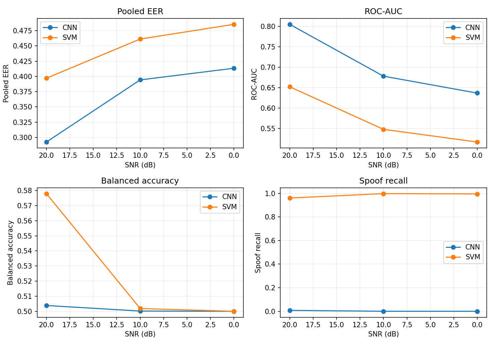
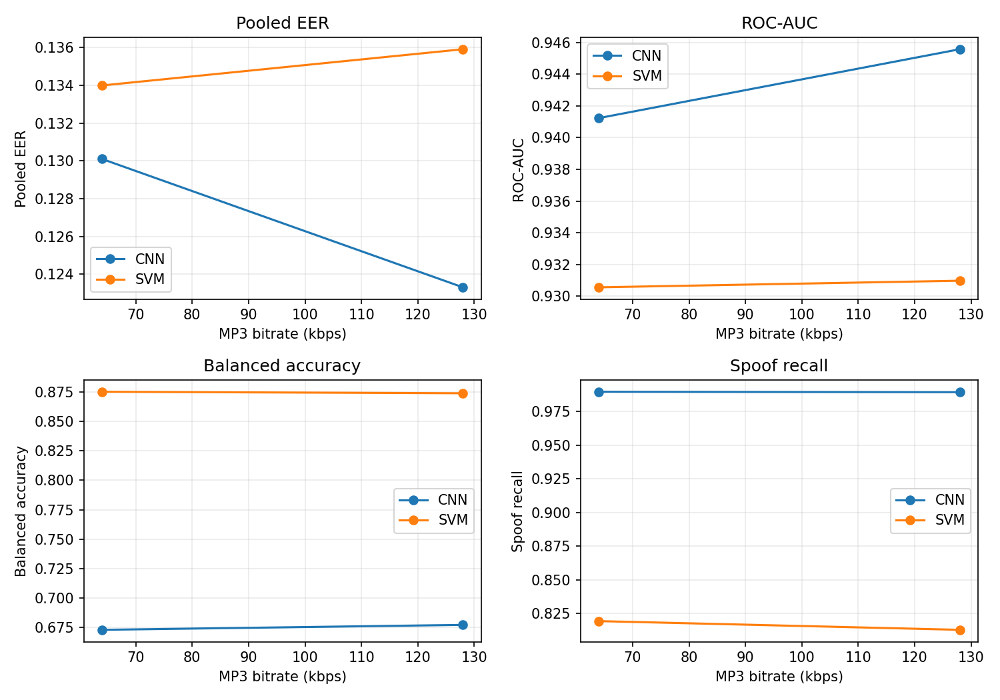

# Phase 4B: fixed-subset robustness (SUBSET RESULTS)

Subset manifest: `subset_manifest.jsonl` (10,000 clips; SHA-256 `f42ddcad02c1d708190278b65d6edba563a7e23a09f12fba761889090992b8ea`). Fixed before any condition scores were examined; reused unchanged for both models and all conditions.

Conditions and models use saved checkpoints with frozen DEV thresholds and TRAIN-fit normalization. No model retraining, threshold retuning, or EVAL-based selection occurred. Perturbed waveforms are generated once per clip/condition and shared by both models. Separate per-model/per-condition feature caches live under `data/feature_cache_phase4b_optimized_v3/`.

## Clean reference on the same subset

| Model | EER | AUC | Balanced accuracy | Spoof recall | Bona fide FPR |
|---|---:|---:|---:|---:|---:|
| CNN | 8.2344% | 0.971571 | 0.886225 | 0.775362 | 0.002913 |
| SVM | 13.8815% | 0.930078 | 0.863781 | 0.791639 | 0.064078 |

## Conditions

All metrics are subset-only; thresholds were selected on the full DEV split and remain frozen. EER is the nearest finite empirical ROC point; per-attack EER uses the subset's shared bona fide pool.

| Condition | Model | Pooled EER | AUC | Balanced accuracy | Spoof recall | Bona fide FPR |
|---|---|---:|---:|---:|---:|---:|
| noise_20dB | CNN | 29.2438% | 0.804872 | 0.503902 | 0.007804 | 0.000000 |
| noise_20dB | SVM | 39.7094% | 0.651955 | 0.577880 | 0.959643 | 0.803883 |
| noise_10dB | CNN | 39.4300% | 0.677935 | 0.500223 | 0.000446 | 0.000000 |
| noise_10dB | SVM | 46.1296% | 0.547710 | 0.501893 | 0.996990 | 0.993204 |
| noise_0dB | CNN | 41.3429% | 0.636500 | 0.500056 | 0.000111 | 0.000000 |
| noise_0dB | SVM | 48.5416% | 0.516664 | 0.500070 | 0.994314 | 0.994175 |
| mp3_128kbps | CNN | 12.3300% | 0.945570 | 0.677173 | 0.989298 | 0.634951 |
| mp3_128kbps | SVM | 13.5910% | 0.930975 | 0.873886 | 0.812821 | 0.065049 |
| mp3_64kbps | CNN | 13.0099% | 0.941227 | 0.672971 | 0.989632 | 0.643689 |
| mp3_64kbps | SVM | 13.3991% | 0.930558 | 0.875177 | 0.819287 | 0.068932 |
| trimmed | CNN | 20.1918% | 0.888638 | 0.801031 | 0.790412 | 0.188350 |
| trimmed | SVM | 30.3893% | 0.764547 | 0.699411 | 0.873579 | 0.474757 |

## Per-attack EER

| Condition | Model | Attack | Spoof N | Shared bona fide N | EER | Miss rate @ frozen threshold |
|---|---|---|---:|---:|---:|---:|
| noise_20dB | CNN | A07 | 690 | 1030 | 23.7773% | 98.2609% |
| noise_20dB | CNN | A08 | 690 | 1030 | 20.1696% | 98.8406% |
| noise_20dB | CNN | A09 | 690 | 1030 | 26.8039% | 99.1304% |
| noise_20dB | CNN | A10 | 690 | 1030 | 23.8983% | 98.4058% |
| noise_20dB | CNN | A11 | 690 | 1030 | 23.3172% | 99.1304% |
| noise_20dB | CNN | A12 | 690 | 1030 | 30.5811% | 99.5652% |
| noise_20dB | CNN | A13 | 690 | 1030 | 23.9468% | 96.6667% |
| noise_20dB | CNN | A14 | 690 | 1030 | 28.2566% | 100.0000% |
| noise_20dB | CNN | A15 | 690 | 1030 | 29.7094% | 100.0000% |
| noise_20dB | CNN | A16 | 690 | 1030 | 26.0532% | 99.8551% |
| noise_20dB | CNN | A17 | 690 | 1030 | 36.6343% | 100.0000% |
| noise_20dB | CNN | A18 | 690 | 1030 | 38.5472% | 100.0000% |
| noise_20dB | CNN | A19 | 690 | 1030 | 40.8717% | 100.0000% |
| noise_20dB | SVM | A07 | 690 | 1030 | 48.0871% | 4.3478% |
| noise_20dB | SVM | A08 | 690 | 1030 | 50.9927% | 11.8841% |
| noise_20dB | SVM | A09 | 690 | 1030 | 33.3172% | 0.4348% |
| noise_20dB | SVM | A10 | 690 | 1030 | 43.6077% | 1.8841% |
| noise_20dB | SVM | A11 | 690 | 1030 | 39.2979% | 0.8696% |
| noise_20dB | SVM | A12 | 690 | 1030 | 36.9734% | 1.8841% |
| noise_20dB | SVM | A13 | 690 | 1030 | 56.0532% | 0.8696% |
| noise_20dB | SVM | A14 | 690 | 1030 | 35.3511% | 4.6377% |
| noise_20dB | SVM | A15 | 690 | 1030 | 31.3318% | 1.7391% |
| noise_20dB | SVM | A16 | 690 | 1030 | 36.2227% | 3.4783% |
| noise_20dB | SVM | A17 | 690 | 1030 | 33.7773% | 4.0580% |
| noise_20dB | SVM | A18 | 690 | 1030 | 38.2566% | 8.1159% |
| noise_20dB | SVM | A19 | 690 | 1030 | 37.0944% | 8.2609% |
| noise_10dB | CNN | A07 | 690 | 1030 | 31.8644% | 100.0000% |
| noise_10dB | CNN | A08 | 690 | 1030 | 33.3172% | 100.0000% |
| noise_10dB | CNN | A09 | 690 | 1030 | 37.8451% | 100.0000% |
| noise_10dB | CNN | A10 | 690 | 1030 | 30.2906% | 99.8551% |
| noise_10dB | CNN | A11 | 690 | 1030 | 29.0073% | 100.0000% |
| noise_10dB | CNN | A12 | 690 | 1030 | 40.4601% | 99.8551% |
| noise_10dB | CNN | A13 | 690 | 1030 | 33.0266% | 99.7101% |
| noise_10dB | CNN | A14 | 690 | 1030 | 43.7773% | 100.0000% |
| noise_10dB | CNN | A15 | 690 | 1030 | 43.6563% | 100.0000% |
| noise_10dB | CNN | A16 | 690 | 1030 | 42.0339% | 100.0000% |
| noise_10dB | CNN | A17 | 690 | 1030 | 47.5545% | 100.0000% |
| noise_10dB | CNN | A18 | 690 | 1030 | 47.6755% | 100.0000% |
| noise_10dB | CNN | A19 | 690 | 1030 | 46.8039% | 100.0000% |
| noise_10dB | SVM | A07 | 690 | 1030 | 54.2374% | 0.2899% |
| noise_10dB | SVM | A08 | 690 | 1030 | 53.3657% | 0.5797% |
| noise_10dB | SVM | A09 | 690 | 1030 | 42.3245% | 0.0000% |
| noise_10dB | SVM | A10 | 690 | 1030 | 53.0266% | 0.2899% |
| noise_10dB | SVM | A11 | 690 | 1030 | 51.2832% | 0.2899% |
| noise_10dB | SVM | A12 | 690 | 1030 | 45.9322% | 0.0000% |
| noise_10dB | SVM | A13 | 690 | 1030 | 63.3172% | 0.8696% |
| noise_10dB | SVM | A14 | 690 | 1030 | 39.8304% | 0.2899% |
| noise_10dB | SVM | A15 | 690 | 1030 | 37.5060% | 0.2899% |
| noise_10dB | SVM | A16 | 690 | 1030 | 40.0000% | 0.4348% |
| noise_10dB | SVM | A17 | 690 | 1030 | 39.1283% | 0.0000% |
| noise_10dB | SVM | A18 | 690 | 1030 | 45.5206% | 0.2899% |
| noise_10dB | SVM | A19 | 690 | 1030 | 38.6682% | 0.2899% |
| noise_0dB | CNN | A07 | 690 | 1030 | 33.7773% | 100.0000% |
| noise_0dB | CNN | A08 | 690 | 1030 | 34.7699% | 100.0000% |
| noise_0dB | CNN | A09 | 690 | 1030 | 38.5472% | 100.0000% |
| noise_0dB | CNN | A10 | 690 | 1030 | 32.1549% | 99.8551% |
| noise_0dB | CNN | A11 | 690 | 1030 | 30.5811% | 100.0000% |
| noise_0dB | CNN | A12 | 690 | 1030 | 42.0339% | 100.0000% |
| noise_0dB | CNN | A13 | 690 | 1030 | 35.5206% | 100.0000% |
| noise_0dB | CNN | A14 | 690 | 1030 | 46.0532% | 100.0000% |
| noise_0dB | CNN | A15 | 690 | 1030 | 45.6416% | 100.0000% |
| noise_0dB | CNN | A16 | 690 | 1030 | 44.1888% | 100.0000% |
| noise_0dB | CNN | A17 | 690 | 1030 | 48.2566% | 100.0000% |
| noise_0dB | CNN | A18 | 690 | 1030 | 48.2566% | 100.0000% |
| noise_0dB | CNN | A19 | 690 | 1030 | 47.2640% | 100.0000% |
| noise_0dB | SVM | A07 | 690 | 1030 | 56.5133% | 1.0145% |
| noise_0dB | SVM | A08 | 690 | 1030 | 51.2832% | 1.0145% |
| noise_0dB | SVM | A09 | 690 | 1030 | 48.1356% | 0.4348% |
| noise_0dB | SVM | A10 | 690 | 1030 | 56.3437% | 1.0145% |
| noise_0dB | SVM | A11 | 690 | 1030 | 55.3511% | 0.8696% |
| noise_0dB | SVM | A12 | 690 | 1030 | 49.1283% | 0.4348% |
| noise_0dB | SVM | A13 | 690 | 1030 | 58.7168% | 0.0000% |
| noise_0dB | SVM | A14 | 690 | 1030 | 44.6489% | 0.5797% |
| noise_0dB | SVM | A15 | 690 | 1030 | 42.4940% | 0.7246% |
| noise_0dB | SVM | A16 | 690 | 1030 | 44.0678% | 0.7246% |
| noise_0dB | SVM | A17 | 690 | 1030 | 41.1622% | 0.1449% |
| noise_0dB | SVM | A18 | 690 | 1030 | 47.0944% | 0.0000% |
| noise_0dB | SVM | A19 | 690 | 1030 | 42.4455% | 0.4348% |
| mp3_128kbps | CNN | A07 | 690 | 1030 | 6.0532% | 0.0000% |
| mp3_128kbps | CNN | A08 | 690 | 1030 | 10.5811% | 0.0000% |
| mp3_128kbps | CNN | A09 | 690 | 1030 | 2.4940% | 0.0000% |
| mp3_128kbps | CNN | A10 | 690 | 1030 | 8.9588% | 0.0000% |
| mp3_128kbps | CNN | A11 | 690 | 1030 | 7.6755% | 0.0000% |
| mp3_128kbps | CNN | A12 | 690 | 1030 | 5.6416% | 0.0000% |
| mp3_128kbps | CNN | A13 | 690 | 1030 | 9.2493% | 0.0000% |
| mp3_128kbps | CNN | A14 | 690 | 1030 | 6.9734% | 0.0000% |
| mp3_128kbps | CNN | A15 | 690 | 1030 | 4.0678% | 0.0000% |
| mp3_128kbps | CNN | A16 | 690 | 1030 | 8.9588% | 0.0000% |
| mp3_128kbps | CNN | A17 | 690 | 1030 | 25.6416% | 7.8261% |
| mp3_128kbps | CNN | A18 | 690 | 1030 | 23.9468% | 2.7536% |
| mp3_128kbps | CNN | A19 | 690 | 1030 | 25.5206% | 3.3333% |
| mp3_128kbps | SVM | A07 | 690 | 1030 | 6.5133% | 6.8116% |
| mp3_128kbps | SVM | A08 | 690 | 1030 | 6.3923% | 4.4928% |
| mp3_128kbps | SVM | A09 | 690 | 1030 | 3.6077% | 0.0000% |
| mp3_128kbps | SVM | A10 | 690 | 1030 | 5.9322% | 1.3043% |
| mp3_128kbps | SVM | A11 | 690 | 1030 | 5.7626% | 0.2899% |
| mp3_128kbps | SVM | A12 | 690 | 1030 | 5.5206% | 0.7246% |
| mp3_128kbps | SVM | A13 | 690 | 1030 | 5.9322% | 0.0000% |
| mp3_128kbps | SVM | A14 | 690 | 1030 | 4.0678% | 0.7246% |
| mp3_128kbps | SVM | A15 | 690 | 1030 | 2.4455% | 0.1449% |
| mp3_128kbps | SVM | A16 | 690 | 1030 | 9.7094% | 12.4638% |
| mp3_128kbps | SVM | A17 | 690 | 1030 | 35.5206% | 77.9710% |
| mp3_128kbps | SVM | A18 | 690 | 1030 | 23.6077% | 62.3188% |
| mp3_128kbps | SVM | A19 | 690 | 1030 | 31.0412% | 76.0870% |
| mp3_64kbps | CNN | A07 | 690 | 1030 | 6.6343% | 0.0000% |
| mp3_64kbps | CNN | A08 | 690 | 1030 | 11.8644% | 0.0000% |
| mp3_64kbps | CNN | A09 | 690 | 1030 | 3.0751% | 0.0000% |
| mp3_64kbps | CNN | A10 | 690 | 1030 | 9.5399% | 0.0000% |
| mp3_64kbps | CNN | A11 | 690 | 1030 | 8.1356% | 0.0000% |
| mp3_64kbps | CNN | A12 | 690 | 1030 | 5.9322% | 0.0000% |
| mp3_64kbps | CNN | A13 | 690 | 1030 | 9.5399% | 0.0000% |
| mp3_64kbps | CNN | A14 | 690 | 1030 | 7.5060% | 0.0000% |
| mp3_64kbps | CNN | A15 | 690 | 1030 | 4.5279% | 0.0000% |
| mp3_64kbps | CNN | A16 | 690 | 1030 | 9.2979% | 0.0000% |
| mp3_64kbps | CNN | A17 | 690 | 1030 | 26.3923% | 7.8261% |
| mp3_64kbps | CNN | A18 | 690 | 1030 | 23.6563% | 2.4638% |
| mp3_64kbps | CNN | A19 | 690 | 1030 | 26.3923% | 3.1884% |
| mp3_64kbps | SVM | A07 | 690 | 1030 | 6.9249% | 7.3913% |
| mp3_64kbps | SVM | A08 | 690 | 1030 | 6.5133% | 4.7826% |
| mp3_64kbps | SVM | A09 | 690 | 1030 | 3.7773% | 0.0000% |
| mp3_64kbps | SVM | A10 | 690 | 1030 | 6.0532% | 1.4493% |
| mp3_64kbps | SVM | A11 | 690 | 1030 | 6.0532% | 0.1449% |
| mp3_64kbps | SVM | A12 | 690 | 1030 | 5.9322% | 0.8696% |
| mp3_64kbps | SVM | A13 | 690 | 1030 | 6.0532% | 0.0000% |
| mp3_64kbps | SVM | A14 | 690 | 1030 | 4.3584% | 0.8696% |
| mp3_64kbps | SVM | A15 | 690 | 1030 | 2.6150% | 0.1449% |
| mp3_64kbps | SVM | A16 | 690 | 1030 | 10.1210% | 13.3333% |
| mp3_64kbps | SVM | A17 | 690 | 1030 | 35.9322% | 78.4058% |
| mp3_64kbps | SVM | A18 | 690 | 1030 | 22.3245% | 55.5072% |
| mp3_64kbps | SVM | A19 | 690 | 1030 | 30.7021% | 72.0290% |
| trimmed | CNN | A07 | 690 | 1030 | 2.4455% | 0.0000% |
| trimmed | CNN | A08 | 690 | 1030 | 5.3511% | 2.1739% |
| trimmed | CNN | A09 | 690 | 1030 | 2.0339% | 0.4348% |
| trimmed | CNN | A10 | 690 | 1030 | 22.7360% | 28.8406% |
| trimmed | CNN | A11 | 690 | 1030 | 8.5472% | 3.4783% |
| trimmed | CNN | A12 | 690 | 1030 | 36.6343% | 63.3333% |
| trimmed | CNN | A13 | 690 | 1030 | 29.1283% | 42.0290% |
| trimmed | CNN | A14 | 690 | 1030 | 24.9395% | 29.7101% |
| trimmed | CNN | A15 | 690 | 1030 | 30.2906% | 44.3478% |
| trimmed | CNN | A16 | 690 | 1030 | 5.6416% | 1.1594% |
| trimmed | CNN | A17 | 690 | 1030 | 36.2227% | 55.3623% |
| trimmed | CNN | A18 | 690 | 1030 | 2.4455% | 0.1449% |
| trimmed | CNN | A19 | 690 | 1030 | 5.0605% | 1.4493% |
| trimmed | SVM | A07 | 690 | 1030 | 27.6755% | 4.3478% |
| trimmed | SVM | A08 | 690 | 1030 | 29.5399% | 0.2899% |
| trimmed | SVM | A09 | 690 | 1030 | 27.5545% | 0.1449% |
| trimmed | SVM | A10 | 690 | 1030 | 27.2154% | 2.7536% |
| trimmed | SVM | A11 | 690 | 1030 | 26.5133% | 0.7246% |
| trimmed | SVM | A12 | 690 | 1030 | 27.3850% | 3.1884% |
| trimmed | SVM | A13 | 690 | 1030 | 27.3850% | 0.8696% |
| trimmed | SVM | A14 | 690 | 1030 | 21.7434% | 0.7246% |
| trimmed | SVM | A15 | 690 | 1030 | 22.7846% | 1.3043% |
| trimmed | SVM | A16 | 690 | 1030 | 25.8112% | 4.7826% |
| trimmed | SVM | A17 | 690 | 1030 | 44.4794% | 40.7246% |
| trimmed | SVM | A18 | 690 | 1030 | 48.8378% | 49.8551% |
| trimmed | SVM | A19 | 690 | 1030 | 50.7021% | 54.6377% |

## Optimization validation

Transformation round trips were compared with the saved float32 waveforms and both feature frontends on 20 deterministic clips per condition; exact equality was observed (maximum absolute difference 0.0). Batch-size-32 inference was compared directly with the saved Phase 4B scores on the same first 32 fixed-subset trials per condition, matching the original prediction batch size; tolerance is 1e-6 in raw score units.

| Condition | CNN vs saved max abs | SVM vs saved max abs |
|---|---:|---:|---:|
| noise_20dB | 0 | 0 |
| noise_10dB | 0 | 0 |
| noise_0dB | 0 | 0 |
| mp3_128kbps | 0 | 0 |
| mp3_64kbps | 0 | 0 |
| trimmed | 0 | 0 |

FFmpeg `ffmpeg version 4.2.2 Copyright (c) 2000-2019 the FFmpeg developers` encoded each MP3 condition with `libmp3lame`, then decoded it back to mono at 16000 Hz. Over 20 clips per bitrate, the decoded-minus-source sample-count ranges were 0 to 8 at 64 kbps and 0 to 8 at 128 kbps. Mean common-prefix codec error RMS was 0.00677878 and 0.00635933, respectively. These measurements document the actual lossy codec round trip; sample padding/encoder delay was not cropped from the experiment waveforms.

Noise SNR was measured per generated clip: the 500-clip preflight plus full-run new generations covered all 10,000 clips per noise condition. Exact minima and maxima are recorded in the condition runtime entries in `phase4b_metrics.json` and `optimized_debug_timing.json`.

## Degradation plots

Interpretation is limited to observed values. Additive synthetic noise is not real-world noise; MP3 results concern the tested FFmpeg codec and bitrates. This is one fixed subset and one seed.

## Runtime and disk

{
  "status": "pass",
  "scope": "500-clip timing only; no benchmark metrics",
  "conditions": {
    "noise_20dB": {
      "wall_seconds": 9.610281000001123,
      "waveform_generation_or_validation_seconds": 3.1703048999443126,
      "waveform_components": {
        "source_decode_seconds": 0.5079690999773447,
        "transform_encode_decode_seconds": 0.4605855000190786,
        "waveform_disk_seconds": 1.0277206999417103,
        "waveform_validation_seconds": 0.48193600002559833
      },
      "cnn_feature_cache_seconds": 2.1552349000339746,
      "svm_feature_cache_seconds": 2.1468698999851767,
      "cnn_inference_seconds": 1.7830559999965772,
      "svm_inference_seconds": 0.22253769999588258,
      "measured_snr_db_min": 19.999999957397122,
      "measured_snr_db_max": 20.00000004158059,
      "measured_snr_samples": 500,
      "optimization_equivalence": {
        "clips_checked": 20,
        "max_waveform_roundtrip_abs_diff": 0.0,
        "max_cnn_feature_abs_diff": 0.0,
        "max_svm_feature_abs_diff": 0.0,
        "previous_mp3_64_waveform_abs_diff": null,
        "previous_mp3_64_cnn_feature_abs_diff": null,
        "previous_mp3_64_svm_feature_abs_diff": null
      }
    },
    "noise_10dB": {
      "wall_seconds": 9.252599100000225,
      "waveform_generation_or_validation_seconds": 3.0822337999888987,
      "waveform_components": {
        "source_decode_seconds": 0.3760330000295653,
        "transform_encode_decode_seconds": 0.4621243999899889,
        "waveform_disk_seconds": 1.0549845000241476,
        "waveform_validation_seconds": 0.4895782999956282
      },
      "cnn_feature_cache_seconds": 2.1661457999762206,
      "svm_feature_cache_seconds": 2.1955176999726973,
      "cnn_inference_seconds": 1.4271244000083243,
      "svm_inference_seconds": 0.24273709999761195,
      "measured_snr_db_min": 9.999999984552682,
      "measured_snr_db_max": 10.000000015686695,
      "measured_snr_samples": 500,
      "optimization_equivalence": {
        "clips_checked": 20,
        "max_waveform_roundtrip_abs_diff": 0.0,
        "max_cnn_feature_abs_diff": 0.0,
        "max_svm_feature_abs_diff": 0.0,
        "previous_mp3_64_waveform_abs_diff": null,
        "previous_mp3_64_cnn_feature_abs_diff": null,
        "previous_mp3_64_svm_feature_abs_diff": null
      }
    },
    "noise_0dB": {
      "wall_seconds": 10.436628100000235,
      "waveform_generation_or_validation_seconds": 3.578347600046982,
      "waveform_components": {
        "source_decode_seconds": 0.4495970999960264,
        "transform_encode_decode_seconds": 0.5795218000203022,
        "waveform_disk_seconds": 1.1929544000049646,
        "waveform_validation_seconds": 0.5609266000319622
      },
      "cnn_feature_cache_seconds": 2.6105587000020023,
      "svm_feature_cache_seconds": 2.6490198000064993,
      "cnn_inference_seconds": 1.1236215000026277,
      "svm_inference_seconds": 0.3076966000007815,
      "measured_snr_db_min": -8.419552279749063e-09,
      "measured_snr_db_max": 8.149740671255386e-09,
      "measured_snr_samples": 500,
      "optimization_equivalence": {
        "clips_checked": 20,
        "max_waveform_roundtrip_abs_diff": 0.0,
        "max_cnn_feature_abs_diff": 0.0,
        "max_svm_feature_abs_diff": 0.0,
        "previous_mp3_64_waveform_abs_diff": null,
        "previous_mp3_64_cnn_feature_abs_diff": null,
        "previous_mp3_64_svm_feature_abs_diff": null
      }
    },
    "mp3_128kbps": {
      "wall_seconds": 80.65938390000156,
      "waveform_generation_or_validation_seconds": 71.78860750001331,
      "waveform_components": {
        "source_decode_seconds": 0.6414139999760664,
        "transform_encode_decode_seconds": 68.65118140000413,
        "waveform_disk_seconds": 1.2766377999942051,
        "waveform_validation_seconds": 0.5045233000382723
      },
      "cnn_feature_cache_seconds": 2.3746147999481764,
      "svm_feature_cache_seconds": 2.349442500020814,
      "cnn_inference_seconds": 3.758066200007306,
      "svm_inference_seconds": 0.25064890000066953,
      "optimization_equivalence": {
        "clips_checked": 20,
        "max_waveform_roundtrip_abs_diff": 0.0,
        "max_cnn_feature_abs_diff": 0.0,
        "max_svm_feature_abs_diff": 0.0,
        "previous_mp3_64_waveform_abs_diff": null,
        "previous_mp3_64_cnn_feature_abs_diff": null,
        "previous_mp3_64_svm_feature_abs_diff": null
      }
    },
    "mp3_64kbps": {
      "wall_seconds": 80.09377299999687,
      "waveform_generation_or_validation_seconds": 71.37823959999878,
      "waveform_components": {
        "source_decode_seconds": 0.7093419999764592,
        "transform_encode_decode_seconds": 68.20982370002821,
        "waveform_disk_seconds": 1.2587325999702443,
        "waveform_validation_seconds": 0.48208389999490464
      },
      "cnn_feature_cache_seconds": 2.354310099970462,
      "svm_feature_cache_seconds": 2.2936557000102766,
      "cnn_inference_seconds": 3.565307099997881,
      "svm_inference_seconds": 0.2549429000027885,
      "optimization_equivalence": {
        "clips_checked": 20,
        "max_waveform_roundtrip_abs_diff": 0.0,
        "max_cnn_feature_abs_diff": 0.0,
        "max_svm_feature_abs_diff": 0.0,
        "previous_mp3_64_waveform_abs_diff": 0.0,
        "previous_mp3_64_cnn_feature_abs_diff": 0.0,
        "previous_mp3_64_svm_feature_abs_diff": 0.0
      }
    },
    "trimmed": {
      "wall_seconds": 7.963789999997971,
      "waveform_generation_or_validation_seconds": 2.6523866999887105,
      "waveform_components": {
        "source_decode_seconds": 0.5477338999698986,
        "transform_encode_decode_seconds": 0.03665259997433168,
        "waveform_disk_seconds": 0.9908622000511969,
        "waveform_validation_seconds": 0.4417589999757183
      },
      "cnn_feature_cache_seconds": 1.8865260000202397,
      "svm_feature_cache_seconds": 1.8655824000379653,
      "cnn_inference_seconds": 1.2217736000093282,
      "svm_inference_seconds": 0.23525610000433517,
      "optimization_equivalence": {
        "clips_checked": 20,
        "max_waveform_roundtrip_abs_diff": 0.0,
        "max_cnn_feature_abs_diff": 0.0,
        "max_svm_feature_abs_diff": 0.0,
        "previous_mp3_64_waveform_abs_diff": null,
        "previous_mp3_64_cnn_feature_abs_diff": null,
        "previous_mp3_64_svm_feature_abs_diff": null
      }
    }
  },
  "clips_per_condition": 500,
  "free_disk_preflight": {
    "free_disk_bytes_before": 132417196032,
    "subset_wave_samples_clean": 502282041,
    "estimated_waveform_bytes_all_conditions": 12057408984,
    "estimated_feature_cache_bytes_all_conditions": 9277689792,
    "estimated_total_bytes": 21335098776,
    "estimated_free_after_bytes": 111082097256,
    "estimate_note": "Uses clean durations and uncompressed float32 WAVs; assumes every condition has clean-length cache arrays, including trimmed. It is conservative for trimmed clips."
  },
  "ffmpeg": "C:\\Games\\projects\\audioguarddeepfake\\audioguard-deepfake-audio-detection-main\\audioguard-deepfake-audio-detection-main\\AudioGuard\\.venv\\Lib\\site-packages\\imageio_ffmpeg\\binaries\\ffmpeg-win64-v4.2.2.exe",
  "seed": 2026,
  "ffmpeg_version": "ffmpeg version 4.2.2 Copyright (c) 2000-2019 the FFmpeg developers",
  "measured_seconds_all_six_conditions": 198.01645509999798,
  "total_six_conditions_both_models_estimate_seconds": 5010.41137749995,
  "total_estimate_method": "Sum of measured wall times for each of six conditions on the identical first 500 fixed-manifest clips, scaled by 10,000/500 and a 25% safety margin plus 60 seconds for startup/reporting. Every timing includes source decode, the condition transform (including actual FFmpeg MP3 encode and decode), float-WAV persistence and hash/manifest I/O, separate CNN and SVM feature cache lookup/extraction/persistence, and batched inference. The first 20 clips per condition also include equivalence validation, making the timing conservative.",
  "runtime_gate_seconds": 10800,
  "free_disk_bytes_after_debug": 131328950272
}
