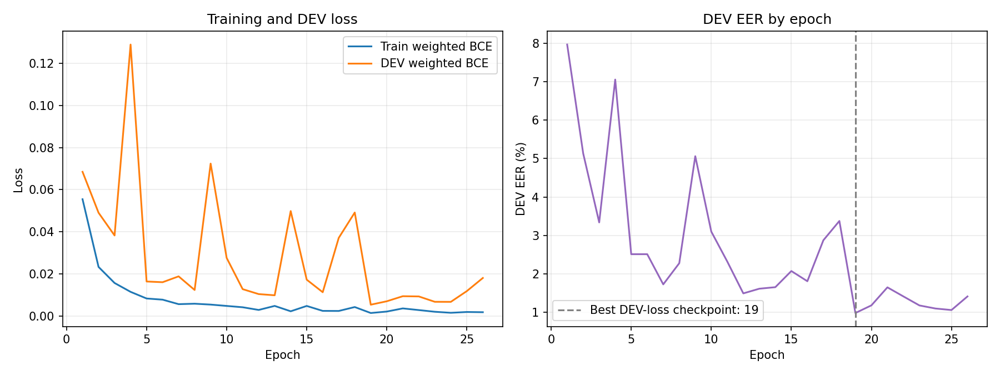

# Phase 3: Log-Mel CNN on ASVspoof 2019 LA

**PART A STATUS: PASS**
**PHASE 3 STATUS: PASS**

This is the completed one-seed (2026) official LA train/dev/eval run and clean-only evaluation. It is a **model/input-pipeline comparison**: representation, pooling, crop/padding, optimizer, and architecture differ between this CNN and the saved MFCC SVM. EVAL was used only for final clean evaluation.

## Environment and GPU

- Required interpreter: `C:\Games\projects\audioguarddeepfake\audioguard-deepfake-audio-detection-main\audioguard-deepfake-audio-detection-main\AudioGuard\.venv\Scripts\python.exe`; code ran from `C:\Games\projects\audioguard-fresh\AudioGuard`.
- NVIDIA GeForce RTX 2050, driver 616.56; PyTorch 2.5.1+cu121, CUDA build 12.1, CUDA available, device count 1; model training device `cuda`.
- `nvidia-smi` report-time memory: 4096 MiB total, 657 MiB used and approximately 3439 MiB free. Instantaneous, not peak training usage. No OOM occurred; batch stayed 32. GPU kernels may be nondeterministic despite seed 2026.
- Full raw current GPU command output is in `gpu_preflight.log`.

## Resolved configuration and data audit

Channels `[16, 32, 64, 128]`, dropout 0.3, 400 frames, batch 32, max epochs 50, learning rate 0.001, weight decay 0.01, patience 7, min_delta 0.0001, seed 2026, workers 0, CPU threads 2; resolved device CUDA. Features: 16 kHz, n_fft/window 512, hop 160, 64 Mel bins, 0–8 kHz, epsilon 1e-8. Resolved settings are saved in `resolved_config_resume.json`.

| Partition | Total | Bona fide (target 0) | Spoof (target 1) | Speakers | Spoof attacks |
|---|---:|---:|---:|---:|---|
| Train | 25,380 | 2,580 | 22,800 | 20 | A01–A06 (3,800 each) |
| DEV | 24,844 | 2,548 | 22,296 | 20 | A01–A06 (3,716 each) |
| EVAL | 71,237 | 7,355 | 63,882 | 67 | A07–A19 (4,914 each) |

Dataset validation found no missing protocol audio, malformed rows, speaker overlap, or utterance overlap. Actual pipeline encoding is target 0=bona fide and target 1=spoof. TRAIN-only positive weight: `2580 / 22800 = 0.11315789473684211` (hex `0x1.cf7ea712dcf7fp-4`). `BCEWithLogitsLoss` receives raw model logits; sigmoid is not applied before loss.

### Feature cache and disk

Only the isolated official cache `data/feature_cache_cnn_logmel` was used; it now contains 121,461 files totaling 10,037,334,144 bytes. Estimate was 10,037,334,144 bytes (9.348 GiB), from 39,147,606 actual target frames, 64 float32 bins, and per-array/header overhead. Disk free after extraction/training at report time: 133,399,851,008 bytes. No MFCC cache was duplicated.

### Crop/padding behavior

After TRAIN-statistic normalization, >400 frames are center-cropped, <400 are right-padded with zeros, exactly 400 are unchanged. Fractions are within each partition/class.

| Partition / class | <400 | =400 | >400 |
|---|---:|---:|---:|
| Train bona fide (2,580) | 2,004 (77.67%) | 0 (0%) | 576 (22.33%) |
| Train spoof (22,800) | 16,561 (72.64%) | 25 (0.11%) | 6,214 (27.25%) |
| DEV bona fide (2,548) | 1,814 (71.19%) | 0 (0%) | 734 (28.81%) |
| DEV spoof (22,296) | 15,772 (70.74%) | 27 (0.12%) | 6,497 (29.14%) |
| EVAL bona fide (7,355) | 5,701 (77.51%) | 0 (0%) | 1,654 (22.49%) |
| EVAL spoof (63,882) | 50,124 (78.46%) | 56 (0.09%) | 13,702 (21.45%) |

## Sanity and debug timing

The official TRAIN 64-sample overfit check passed on CUDA: accuracy 0.953125 and loss 0.15184240555390716 at epoch 18 (required accuracy ≥0.95, loss ≤0.2). DEBUG ONLY timing on a 1,024-sample stratified TRAIN subset: train pass 6.5445 s, validation 2.6637 s; extrapolated full epoch 226.832 s and 50 epochs about 3.15 h. These are planning estimates, not benchmark results.

## Full training

- Ran 26 of 50 maximum epochs; checkpoint selected at epoch 19 by minimum DEV weighted BCE. Early stopping triggered after 7 epochs without sufficient DEV-loss improvement. Runtime 6866.569 seconds (1.907 hours).
- Training loss declined to 0.00191392 and accuracy rose to 0.99685 by epoch 26. DEV loss was lowest at checkpoint epoch 19; afterwards it increased/varied while train loss continued falling. DEV EER minimum and DEV loss minimum need not coincide because checkpoint policy is DEV loss only. This is evidence of overfit after the best-loss point; stop policy was unchanged.
- Per-epoch train/DEV loss and DEV EER are in `cnn_logmel/training.json` and the persistent log. GPU nondeterminism applies.

## Clean metrics

Spoof is the positive class. Confusion matrices use true rows `[bona fide, spoof]` and predicted columns `[bona fide, spoof]`. FPR = FP/all bona fide; FNR = FN/all spoof. Frozen thresholds were selected on DEV and reused unchanged on EVAL. EER reports both nearest finite ROC point and linear interpolation.

CNN frozen threshold: `0.1990397870540619`. Saved raw values are logits; target 1 is spoof and higher logit indicates spoof. Original-score vs negated-score ROC-AUC: DEV 0.999523 vs 0.000477; EVAL 0.969237 vs 0.030763.

| Partition | Model | ROC-AUC | EER nearest / interpolated | Spoof F1 | Macro-F1 | Balanced acc. | Accuracy | Spoof recall | Confusion matrix | FPR FP/BF | FNR FN/spoof |
|---|---|---:|---:|---:|---:|---:|---:|---:|---|---:|---:|
| DEV | CNN | 0.999523 | 0.981700% / 0.981162% | 0.994504 | 0.974190 | 0.990183 | 0.990179 | 0.990178 | [[2523, 25], [219, 22077]] | 0.009812 (25/2548) | 0.009822 (219/22296) |
| DEV | SVM | 0.971922 | 8.242695% / 8.241758% | 0.952332 | 0.823876 | 0.917573 | 0.917566 | 0.917564 | [[2338, 210], [1838, 20458]] | 0.082418 (210/2548) | 0.082436 (1838/22296) |
| EVAL | CNN | 0.969237 | 8.456524% / 8.456832% | 0.875489 | 0.691217 | 0.884696 | 0.801185 | 0.779453 | [[7281, 74], [14089, 49793]] | 0.010061 (74/7355) | 0.220547 (14089/63882) |
| EVAL | SVM | 0.938992 | 12.782465% / 12.784509% | 0.880313 | 0.693117 | 0.872889 | 0.807305 | 0.790238 | [[7028, 327], [13400, 50482]] | 0.044460 (327/7355) | 0.209762 (13400/63882) |

CNN class metrics, bona fide then spoof: DEV precision 0.920131/0.998869, recall 0.990188/0.990178; EVAL precision 0.340711/0.998516, recall 0.989939/0.779453.

### Per-attack EER and miss rates

Per-attack EER uses that attack's spoof trials plus the shared bona fide pool for the partition. Miss rate is misses / attack spoof trials using each model's frozen DEV threshold. Values show nearest / interpolated EER.

| Partition / attack | Spoof trials | Shared bona fide | CNN EER nearest / interp. | CNN miss | SVM EER nearest / interp. | SVM miss |
|---|---:|---:|---:|---:|---:|---:|
| DEV A01 | 3716 | 2548 | 0.9884% / 0.9957% | 1.0226% | 5.4921% / 5.4945% | 0.4306% |
| DEV A02 | 3716 | 2548 | 0.1592% / 0.1570% | 0.0807% | 3.8007% / 3.7944% | 1.1572% |
| DEV A03 | 3716 | 2548 | 1.0680% / 1.0764% | 1.2379% | 6.5602% / 6.5662% | 5.2476% |
| DEV A04 | 3716 | 2548 | 1.6119% / 1.6091% | 2.3143% | 10.2347% / 10.2260% | 12.5673% |
| DEV A05 | 3716 | 2548 | 1.0680% / 1.0764% | 1.1841% | 8.0790% / 8.0732% | 7.8579% |
| DEV A06 | 3716 | 2548 | 0.3184% / 0.3229% | 0.0538% | 13.9692% / 13.9717% | 22.2013% |
| EVAL A07 | 4914 | 7355 | 0.3667% / 0.3671% | 0.0000% | 5.7212% / 5.7240% | 10.1750% |
| EVAL A08 | 4914 | 7355 | 1.9727% / 1.9714% | 3.8055% | 4.5396% / 4.5411% | 5.1689% |
| EVAL A09 | 4914 | 7355 | 0.5059% / 0.5088% | 0.1832% | 2.7876% / 2.7872% | 0.0000% |
| EVAL A10 | 4914 | 7355 | 5.1508% / 5.1486% | 21.6728% | 4.0744% / 4.0789% | 3.0525% |
| EVAL A11 | 4914 | 7355 | 1.7282% / 1.7298% | 2.6252% | 3.8639% / 3.8613% | 0.1018% |
| EVAL A12 | 4914 | 7355 | 9.8058% / 9.8029% | 34.8189% | 3.8639% / 3.8613% | 2.7880% |
| EVAL A13 | 4914 | 7355 | 7.9553% / 7.9569% | 42.1856% | 3.8639% / 3.8613% | 0.0611% |
| EVAL A14 | 4914 | 7355 | 7.4732% / 7.4779% | 28.2865% | 2.8928% / 2.8897% | 0.9972% |
| EVAL A15 | 4914 | 7355 | 10.5392% / 10.5413% | 48.2499% | 2.5669% / 2.5641% | 0.9361% |
| EVAL A16 | 4914 | 7355 | 1.1408% / 1.1396% | 1.3024% | 9.5443% / 9.5445% | 18.3150% |
| EVAL A17 | 4914 | 7355 | 30.2221% / 30.2198% | 95.9707% | 34.3542% / 34.3576% | 81.7257% |
| EVAL A18 | 4914 | 7355 | 1.1646% / 1.1693% | 1.3228% | 22.5520% / 22.5561% | 69.5157% |
| EVAL A19 | 4914 | 7355 | 2.6076% / 2.6048% | 6.2882% | 28.4531% / 28.4568% | 79.8535% |

The requested pairs DEV A04/EVAL A16 and DEV A06/EVAL A19 are shown in the table, with measured EER and miss rates. A16/A19 have reported algorithm-reuse relationships with A04/A06. A07–A19 are unseen attack IDs in train/dev, but this does not establish generalization to an independent dataset or external speech-generation system.

## SVM comparison

| EVAL baseline / model | Accuracy | Spoof F1 | Macro-F1 | Balanced accuracy |
|---|---:|---:|---:|---:|
| Always spoof | 0.896753 | 0.945567 | 0.472783 | 0.500000 |
| MFCC SVM | 0.807305 | 0.880313 | 0.693117 | 0.872889 |
| Log-Mel CNN | 0.801185 | 0.875489 | 0.691217 | 0.884696 |

CNN minus SVM on EVAL: pooled nearest EER -0.043259 (improvement), ROC-AUC +0.030245 (improvement), balanced accuracy +0.011806 (improvement), spoof recall -0.010786 (regression). This is mixed evidence; it does not support declaring an overall winner from a single metric.

Independent `recompute_phase3.py` validated score CSVs before metric calculation: DEV 24,844 and EVAL 71,237 unique protocol trials; correct labels, speaker/attack IDs; no missing values, duplicate IDs, or nonfinite scores. It used sklearn `roc_curve` and `roc_auc_score`. Independently recomputed CNN DEV/EVAL and saved Phase 2 SVM DEV/EVAL metrics all match saved evaluator values within 1e-12. The saved evaluator's diagnostic EER uses nearest empirical operating point (mean FPR/FNR); the additional interpolated EER linearly crosses neighboring ROC points and differs slightly by design.

Published ASVspoof 2019 LA baseline EERs, LFCC-GMM 8.09% and CQCC-GMM 9.57%, are contextual only and use different pipelines ([official ASVspoof 2019 evaluation plan](https://www.asvspoof.org/asvspoof2019/asvspoof2019_evaluation_plan.pdf), [published baseline results](https://www.apsipa.org/proceedings/2019/pdfs/246.pdf)). Official convention treats bona fide as positive; AudioGuard uses spoof as positive, consistently for this analysis.

## Verification and scope

Final test/verifier exit codes are recorded in the task completion report. Phase 2 SVM input hashes match before/after; `results/real_svm/` was not changed. `MANIFEST.sha256.json` remains unchanged. Only `data/feature_cache_cnn_logmel` was used; protected synthetic dirs were not accessed. No CNN-MFCC, robustness, shortcut, external-source experiment, or demo was run. Bulk model/cache/score artifacts, ignored local configs, and logs remain local and are excluded from the commit.
